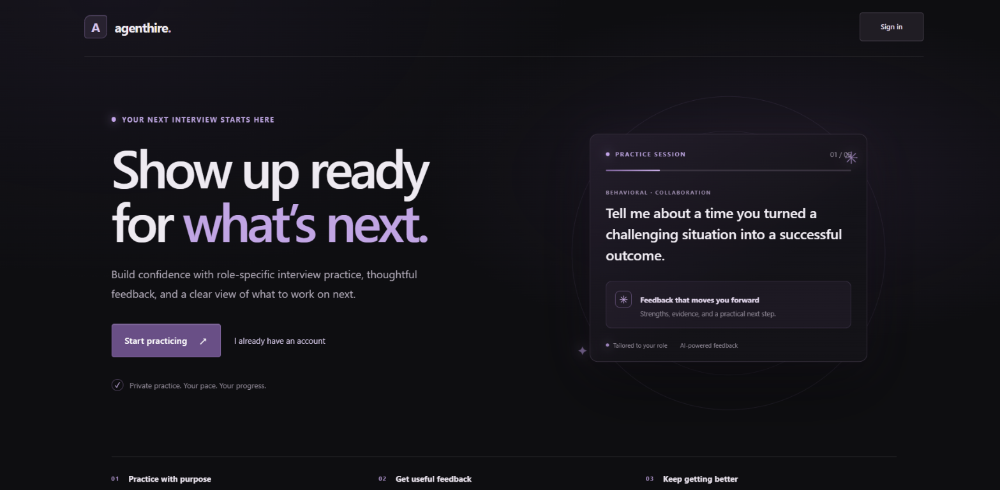
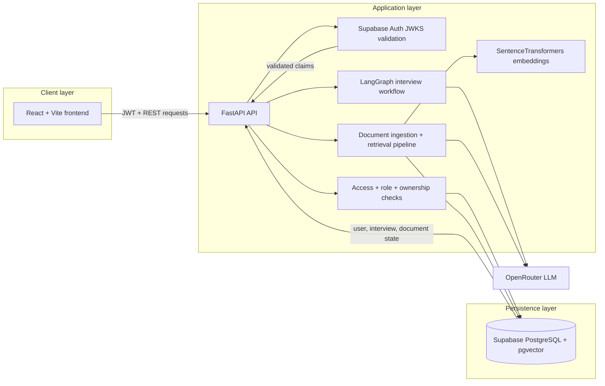
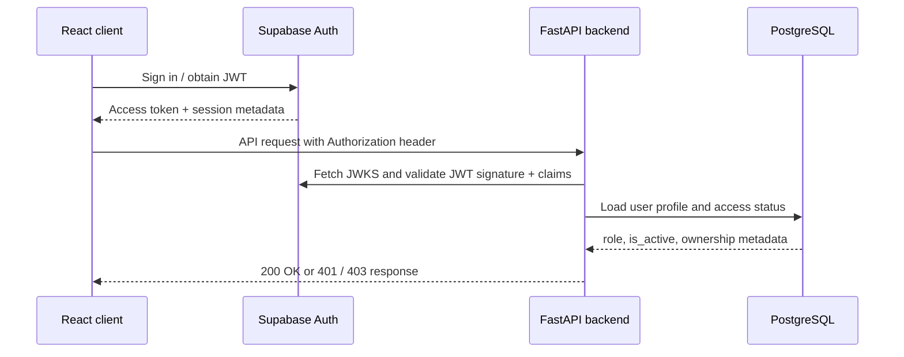
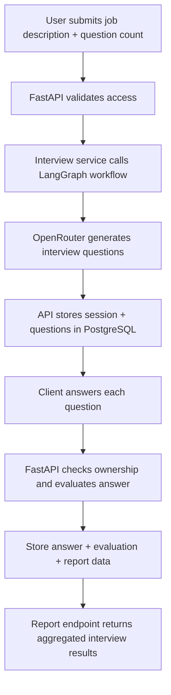
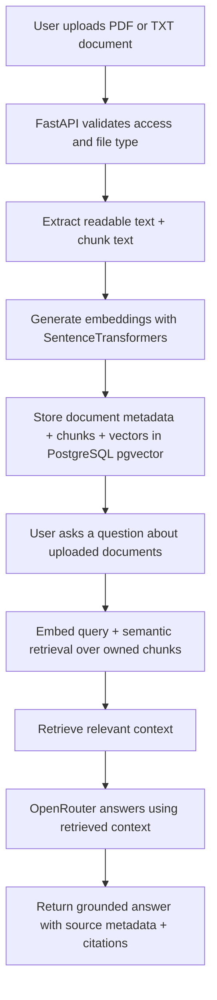

# AgentHire AI

**AI-assisted, role-aware interview practice grounded in job descriptions and uploaded documents.**

AgentHire AI is a web application for creating structured interviews, submitting answers for AI-assisted evaluation, reviewing a final report, and asking questions against a user's indexed documents. The React client calls a FastAPI API; Supabase provides authentication and PostgreSQL persistence, and OpenRouter supplies chat-completion responses.

> **Project status:** The source tree and local automated checks are available, but this repository has not yet been published to GitHub and the application has not been verified as a public deployment. The Docker setup builds the **backend API only**; the React frontend is run separately.

## Screenshots



- Sign-in / landing screen
- Interview workspace with generated questions
- Answer evaluation and final report
- Admin access-management view
- Document upload, semantic search, and grounded answer
- FastAPI Swagger UI at `/docs`

## Features

- Supabase Auth sign-in and JWT verification by the backend.
- Admin/user roles and an independently enforced application-access flag.
- Admin-only user search, listing, and grant/revoke access operations.
- Protected interview, report, upload, search, and question-answering routes.
- Interview sessions with up to five generated questions, persisted session and question UUIDs, answer submission, evaluation, and report retrieval.
- LangGraph workflows for question generation and answer evaluation.
- PDF and UTF-8 text upload, extraction, character-based chunking, embedding, and persistence.
- Owner-scoped semantic retrieval over PostgreSQL `pgvector`.
- Retrieval-grounded answers with source metadata and source-number citations when relevant document chunks are found.

These features are present in the code and covered by selected backend tests. A successful local test suite is not equivalent to a live Supabase, authenticated-browser, or paid-provider end-to-end test. Those integrations need to be verified against the operator's own configured services.

## Technology stack

| Layer | Technologies |
| --- | --- |
| Frontend | React 19, Vite 8, JavaScript, CSS |
| API | Python, FastAPI, Pydantic, Uvicorn |
| Persistence | SQLAlchemy 2, PostgreSQL, Supabase PostgreSQL, Alembic |
| Authentication | Supabase Auth; backend ES256 JWT validation against Supabase JWKS |
| Interview AI | LangGraph workflows, OpenRouter chat completions |
| RAG | PyPDF, Hugging Face Sentence Transformers (`all-MiniLM-L6-v2`), PostgreSQL `pgvector` |
| Tests / quality | pytest, ESLint, Python `compileall`, Vite production build |
| Packaging | Docker, Docker Compose |

The embedding model runs in the backend process; it is not an OpenRouter-hosted embedding API.

## Architecture



The frontend authenticates with Supabase and sends JWT-backed requests to the FastAPI API. The backend validates tokens, checks active access and role, persists interview and document state in PostgreSQL, and calls LangGraph or retrieval services when needed. Embeddings are generated locally in the backend with Sentence Transformers, while LLM-generated interview questions, evaluations, and grounded answers come from OpenRouter.

## Request and data flows

### 1) Authentication and access flow



`GET /api/v1/auth/me` returns the current role and `is_active` state for the signed-in user. Protected routes require an active account, and admin routes require `role=admin`. Ownership checks are enforced in the API layer for sessions, questions, and documents.

### 2) Interview generation and evaluation flow



This process creates a user-owned interview session, persists generated question IDs, receives submitted answers, evaluates each answer, and consolidates the final report from the stored records.

### 3) RAG document ingestion and grounded answer flow



PDF and TXT uploads are processed in the backend, chunked, embedded, and stored for semantic search. Grounded answers combine the user's question with the most relevant retrieved document chunks to produce cited responses with source context.
## Repository layout

```text
.
├── app/
│   ├── admin_bootstrap.py       # Trusted, explicit initial-admin bootstrap
│   ├── admin_routes.py          # Admin user access API
│   ├── auth.py                  # JWT, active-user, and admin dependencies
│   ├── database.py              # SQLAlchemy engine and session dependency
│   ├── document_service.py      # PDF/TXT extraction and chunking
│   ├── embedding_service.py     # Cached Sentence Transformer model
│   ├── interview_graph.py       # LangGraph question/evaluation workflows
│   ├── interview_service.py     # Interview question generation
│   ├── llm_service.py           # OpenRouter client
│   ├── main.py                  # FastAPI routes and schemas
│   ├── models.py                # SQLAlchemy models
│   ├── ownership.py             # Owner-scoped record lookup helpers
│   ├── rag_qa_service.py        # Retrieval-grounded answers
│   ├── rag_service.py           # Document indexing
│   ├── retrieval_service.py     # pgvector semantic search
│   └── test_*.py                # Backend unit/API tests
├── frontend/
│   ├── src/                     # React app, admin UI, API client and styles
│   ├── public/                  # Static public assets
│   ├── package.json             # Frontend scripts and dependencies
│   └── vercel.json              # SPA rewrite for Vercel hosting
├── migrations/
│   ├── env.py                   # Alembic configuration
│   └── versions/                # Ownership and access migrations
├── Dockerfile                   # Backend API image
├── docker-compose.yml           # Local backend container
├── render.yaml                  # Render Blueprint (not deployed)
├── requirements.txt             # Backend dependencies
└── README.md
```

Generated folders, virtual environments, local `.env` files, and frontend dependencies are omitted.

## Prerequisites

- Git
- A Python version compatible with the dependencies; the deployment Blueprint selects Python 3.12.8 for native ML package compatibility.
- Node.js/npm compatible with the installed Vite toolchain.
- Docker Desktop with its Linux container engine running, if building/running Docker.
- A Supabase project with the expected PostgreSQL schema and pgvector available.
- An OpenRouter account/API key for LLM-backed interview, evaluation, and RAG calls.

The sentence-transformers/PyTorch dependency makes the backend image substantially larger than a minimal FastAPI image and adds memory and cold-start cost.

## Local setup

After publishing, replace `<OWNER>` and `<REPOSITORY>` with the actual GitHub repository:

```powershell
git clone https://github.com/<OWNER>/<REPOSITORY>.git
Set-Location <REPOSITORY>

py -3.12 -m venv .venv
.\.venv\Scripts\Activate.ps1
python -m pip install --upgrade pip
python -m pip install -r requirements.txt

Copy-Item .env.example .env
Copy-Item frontend\.env.example frontend\.env
```

Edit the two ignored `.env` files locally with the variable names listed below. Do not paste secret values into shell history, source control, screenshots, issue reports, or frontend variables. Install and run the frontend:

```powershell
Set-Location frontend
npm ci
npm run dev -- --host 127.0.0.1
```

In a second PowerShell terminal at the repository root, run the backend:

```powershell
.\.venv\Scripts\Activate.ps1
python -m uvicorn app.main:app --host 127.0.0.1 --port 8001
```

Open the frontend at `http://127.0.0.1:5173`, API health at `http://127.0.0.1:8001/health`, and Swagger UI at `http://127.0.0.1:8001/docs`. The frontend's API client otherwise falls back to `http://127.0.0.1:8000`, so set `VITE_API_URL=http://127.0.0.1:8001` in `frontend/.env` for the command above.

### Database migrations and administrator bootstrap

The database must have the migrations expected by the application. Migration application is an explicit database operation: inspect the target project and current revision, review generated SQL and obtain the database owner's approval before running `alembic upgrade head`. Do not run migrations automatically during a container build or service startup.

The initial-admin bootstrap is a separate trusted command. It requires server-side Supabase Auth Admin credentials, uses an existing matching Auth account without resetting its password, and writes that account's profile. Do not run it unless deliberately provisioning an administrator against the intended database:

```powershell
.\.venv\Scripts\python.exe -m app.admin_bootstrap
```

For the Docker image, the equivalent one-shot form is `docker run --rm --env-file .env --entrypoint python agenthire-api:local -m app.admin_bootstrap`. This explicitly starts a separate command and does not run during normal API startup.

## Environment variables

| Variable | Used by | Required / default | Exposure |
| --- | --- | --- | --- |
| `DATABASE_URL` | SQLAlchemy and Alembic | Required for backend/database operations | Confidential |
| `SUPABASE_URL` | Backend JWT issuer/JWKS and admin bootstrap | Required for auth; project URL | Configuration |
| `SUPABASE_SECRET_KEY` | Trusted admin bootstrap only | Required for bootstrap, unless legacy variable is used | **Confidential server-side credential** |
| `SUPABASE_SERVICE_ROLE_KEY` | Legacy alternative for admin bootstrap | Optional if `SUPABASE_SECRET_KEY` is set | **Confidential server-side credential** |
| `OPENROUTER_API_KEY` | Backend LLM client | Required when making model calls | **Confidential server-side credential** |
| `OPENROUTER_MODEL` | Backend LLM client | Defaults to `nvidia/nemotron-3-ultra-550b-a55b:free` | Server configuration |
| `OPENROUTER_BASE_URL` | Backend LLM client | Defaults to `https://openrouter.ai/api/v1` | Server configuration |
| `INITIAL_ADMIN_EMAIL` | Explicit admin bootstrap | Defaults to the project bootstrap email | Server configuration |
| `INITIAL_ADMIN_PASSWORD` | Explicit admin bootstrap | Required only if bootstrap must create a new Auth user; existing passwords are not reset | **Confidential server-side credential** |
| `FRONTEND_ORIGINS` | FastAPI CORS | Defaults to localhost Vite origins; comma-separated exact origins | Public origin list |
| `APP_ENV` | API root response / configuration | Defaults to `development` | Non-secret configuration |
| `VITE_API_URL` | Frontend API client | Defaults to `http://127.0.0.1:8000` | Public URL |
| `VITE_SUPABASE_URL` | Browser Supabase client | Required for frontend authentication | Public configuration |
| `VITE_SUPABASE_ANON_KEY` | Browser Supabase client | Required; Supabase anon/publishable key only | Public key by design |

The root `.env` is for backend/runtime settings; `frontend/.env` is for `VITE_*` settings. **Never put a Supabase secret/service-role key, database credential, or OpenRouter key in any `VITE_*` variable.** Frontend variables are embedded in the browser build.

`APP_HOST` and `APP_PORT` appear in the sample environment, but the documented local Uvicorn command and container start command set their bind host/port directly.

## API reference

All protected routes require `Authorization: Bearer <Supabase access token>`. Application routes require active application access. Admin routes require an active administrator. The precise OpenAPI schemas are available from the running service at `/openapi.json`.

| Method | Path | Access | Purpose |
| --- | --- | --- | --- |
| `GET` | `/` | Public | API welcome/status response |
| `GET` | `/health` | Public | Health response |
| `GET` | `/api/v1/auth/me` | Authenticated | Current profile ID, role, and access state |
| `POST` | `/api/v1/interview/question` | Active user | Generate one interview question |
| `POST` | `/api/v1/interview/evaluate` | Active user | Evaluate a submitted answer |
| `POST` | `/api/v1/interview/run` | Active user | Run the combined question/answer workflow |
| `POST` | `/api/v1/interview/session` | Active user | Create a persisted interview session with 1–5 questions |
| `POST` | `/api/v1/interview/sessions/{session_id}/questions/{question_id}/answer` | Active owner | Persist answer and evaluation for an owned question |
| `GET` | `/api/v1/interview/sessions/{session_id}/report` | Active owner | Retrieve report for an owned session |
| `POST` | `/api/v1/documents/upload` | Active user | Upload and index a PDF or TXT file (up to 5 MiB) |
| `POST` | `/api/v1/search` | Active user | Search the user's indexed documents |
| `POST` | `/api/v1/ask` | Active user | Ask a retrieval-grounded question over owned documents |
| `GET` | `/api/v1/admin/users` | Active admin | Paginated user listing and optional email search |
| `PATCH` | `/api/v1/admin/users/{user_id}/access` | Active admin | Grant/revoke another profile's application access |

Interactive docs: `http://127.0.0.1:8001/docs` for the local command above.

## Data model and migrations

- `user_profiles.id` corresponds to the Supabase Auth user UUID. Profiles store `role`, `is_active`, and creation time; application authorization is based on the profile, not user-editable frontend state.
- `interview_sessions` have an optional owner and contain ordered `questions`.
- `candidate_answers` refer to questions; `evaluations` refer to answers.
- `documents` have an optional owner and contain `document_chunks`.
- Each chunk stores content and a nullable `pgvector` embedding with 384 dimensions, plus JSON metadata.

The migration history adds ownership fields/constraints and then the default-denied `is_active` profile field. Confirm the configured database and current revision before any migration. The default local procedure is not to point this checkout at production by accident; migrations are not part of Docker startup.

## Docker

This repository's Docker image runs the **FastAPI backend only**. It relies on the existing external Supabase Auth/PostgreSQL and OpenRouter services; it does not start replacement local services. Run the React frontend separately (locally, on Vercel, or in a separately configured frontend container).

1. Create the local backend environment file from the blank template and fill it privately:

   ```powershell
   Copy-Item .env.example .env
   ```

   At minimum, configure `DATABASE_URL`, `SUPABASE_URL`, and `OPENROUTER_API_KEY`. `FRONTEND_ORIGINS` should contain the exact browser origin(s).

2. Build and start the API:

   ```powershell
   docker compose up --build -d
   ```

3. Check health and logs:

   ```powershell
   Invoke-RestMethod http://127.0.0.1:8001/health
   docker compose ps
   docker compose logs --tail 100 api
   ```

4. Stop it:

   ```powershell
   docker compose down
   ```

The local image tag is `agenthire-api:local`. The backend listens on container port 8000 and Compose exposes it at host port 8001. The image runs as a non-root user and has a `/health` Docker health check. `.dockerignore` excludes environment files, Git data, frontend dependencies, local virtual environments, and test artifacts.

Secrets are supplied to the running container from the local root `.env` through Compose interpolation; they are not Docker build arguments, copied files, or image layers. Do not use `ARG` or `ENV` in the Dockerfile for secret values, and do not publish an image built from an accidentally secret-bearing context. If the trusted admin bootstrap is intentionally needed in a container, use a separate one-shot invocation with the secret environment supplied at runtime—never as part of normal service startup.

The Docker image has not been built or smoke-tested in this environment yet; Docker Desktop's daemon was unavailable during checks.

## Testing and quality checks

From the project root:

```powershell
.\.venv\Scripts\python.exe -m pytest app -q --tb=short
.\.venv\Scripts\python.exe -m compileall -q app
Set-Location frontend
npm run lint
npm run build
Set-Location ..
docker build -t agenthire-api:local .
```

The most recent local run before Docker/README authoring passed **41 backend tests**, Python compilation, frontend ESLint, and Vite production build. Those results do not verify a live Supabase connection, authenticated browser flow, OpenRouter call, or Docker image. Run the commands above again after changes; Docker commands require a running Docker engine.

## Security and privacy notes

- Backend JWT verification validates Supabase signing keys and token claims; protected routes load the database profile and check active status.
- Admin routes use a backend admin dependency; user-access updates reject self-access changes.
- Interview and document lookups are owner-scoped in the API.
- The admin bootstrap is a local trusted command, not a public API route, and does not reset an existing account password.
- `.env`, frontend `.env`, and environment variants are ignored; only blank `.env.example` templates belong in source control.
- Browser `VITE_*` settings are public. Supabase server credentials, database credentials, and OpenRouter credentials must remain server-side.
- Application-level access checks are implemented; database RLS policy coverage has not been independently verified here. Treat database credentials and access to the Supabase project as sensitive.
- Do not send private candidate data or secrets to third-party services unless permitted by your privacy, consent, and retention requirements. AI provider requests may process the submitted prompt content.

## Deployment

Deployment configuration is present but **no live deployment has been performed**. The repository includes a Render Blueprint for the API and a Vercel SPA rewrite for the frontend.

- Render needs `DATABASE_URL`, `SUPABASE_URL`, `OPENROUTER_API_KEY`, and `FRONTEND_ORIGINS` configured in the service dashboard. `FRONTEND_ORIGINS` must be exact production origins; do not use `*`.
- Set Vercel's project root to `frontend`. Configure `VITE_API_URL` to the Render API origin, plus `VITE_SUPABASE_URL` and only the public `VITE_SUPABASE_ANON_KEY`.
- After the Vercel domain is assigned, add its exact origin to Render CORS configuration.
- Add the deployed frontend URL to the Supabase Auth allowed redirect/site URL configuration as appropriate for the project's sign-in flow.
- Review migration state before deploying a new schema. Do not apply migrations automatically on each service start.
- The Render free tier may sleep and has limited memory. The local Sentence Transformers/PyTorch model can cause slow cold starts or memory exhaustion on a small instance; validate actual workloads before relying on it.

This setup guide is not evidence that either provider has deployed or that the public authentication/interview/RAG flow works.

## Troubleshooting

| Symptom | Check |
| --- | --- |
| API exits during startup | `DATABASE_URL` must be set; check backend startup logs without sharing credentials. |
| 401 on protected route | Sign in again; verify the API is pointed at the same Supabase project as the frontend and that the token is current. |
| 403 / access denied | Check the trusted `user_profiles` role and `is_active` state; do not edit frontend state as a workaround. |
| Profile schema / database errors | Confirm the intended database has reviewed ownership/access migrations applied. |
| `pgvector` or vector-column errors | Confirm the target PostgreSQL instance has the extension/schema expected by the migrations and model. |
| LLM operation fails | Check that the server-side `OPENROUTER_API_KEY` and configured model are valid and that the provider is reachable. Never print the key or request headers. |
| Frontend cannot reach backend | Check `VITE_API_URL`, API health, and backend `FRONTEND_ORIGINS`; restart the Vite dev server after changing frontend env. |
| Docker Compose rejects required variable | Fill the named backend values in root `.env`; do not put secrets in the compose file. |
| Docker cannot connect/build | Start Docker Desktop's Linux engine and retry; first image build downloads Python dependencies and the ML stack. |
| RAG is slow or container restarts | The embedding model is loaded locally and uses memory; check container resources and logs, and test with representative documents. |
| PDF upload contains no text | Scanned PDFs need OCR; OCR is not implemented in the current extractor. |

## Roadmap

Potential future work (not represented as already implemented): capture a sanitized screenshot set; improve bounded background processing for large document indexing; evaluate production-friendly embedding deployment and memory profiles; add broader end-to-end tests against isolated Supabase-compatible infrastructure.

## Contributing

1. Fork the repository and create a focused feature branch.
2. Configure local services and ignored `.env` files; never commit credentials.
3. Add or update tests for behavior changes.
4. Run backend tests, Python compilation, frontend lint/build, and (if available) the Docker build.
5. Open a pull request describing behavior, tests, and any database migration implications.

Do not include real candidate data, credentials, or production database exports in pull requests.

## License

No license has been selected for this repository. Until a license is added, do not assume that reuse, redistribution, or commercial use is permitted.

## Acknowledgements

AgentHire AI is built with React, Vite, FastAPI, SQLAlchemy, Supabase, PostgreSQL, pgvector, LangGraph, OpenRouter, Hugging Face Sentence Transformers, PyPDF, Alembic, pytest, ESLint, and Docker. Each upstream project retains its own license and terms.
